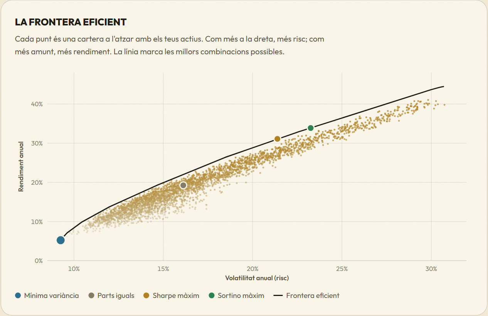
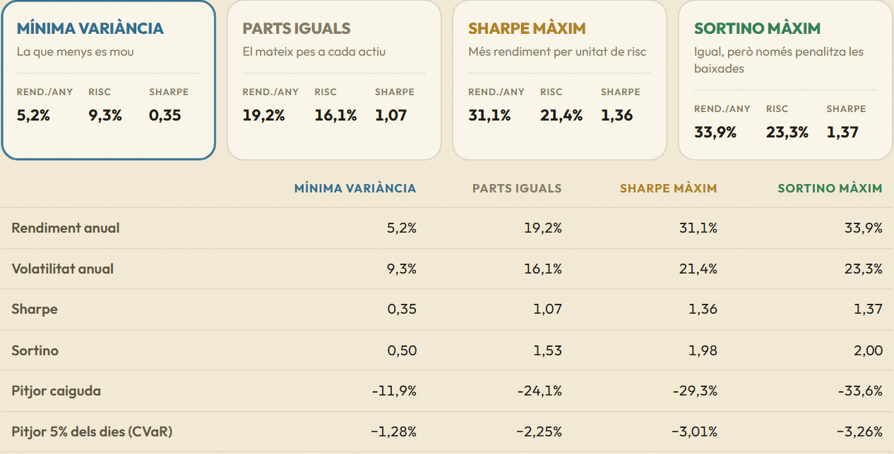
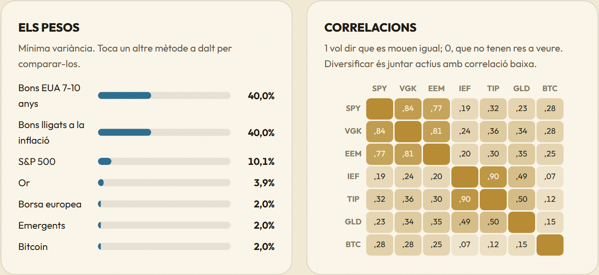
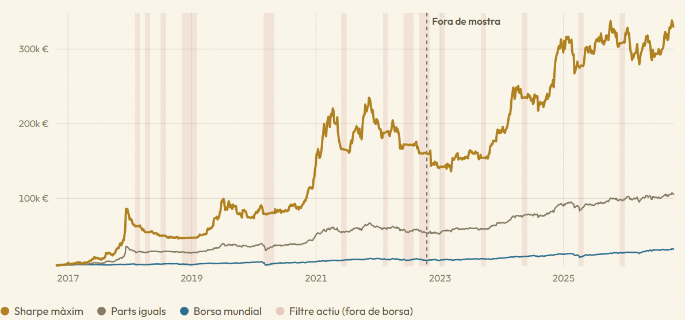

# Portfolio Analyzer

**Live demo: [invertirsensecorbata.com/cartera](https://invertirsensecorbata.com/cartera/)** (interface in Catalan)

A mean-variance portfolio optimiser and backtester that runs entirely in the browser. Pick 2 to 12 assets out of 17 ETFs (equities, bonds, gold, commodities, bitcoin), set weight limits and a risk-free rate, and get:

- the **efficient frontier** with a 4,000-portfolio Monte Carlo cloud,
- four allocations: **minimum variance**, **equal weight (1/N)**, **maximum Sharpe** and **maximum Sortino**,
- annualised return, volatility, Sharpe, Sortino, maximum drawdown and daily CVaR 95%,
- the **correlation matrix**,
- a **backtest since 2007** in euros with annual/monthly/no rebalancing, monthly contributions, an optional **crash filter** and an **out-of-sample split**.

No server, no sign-up, no dependencies. The engine is ~170 lines of plain JavaScript and returns the same weights as SciPy's SLSQP (see [Validation](#validation)).



| Methods | Weights and correlations |
|---|---|
|  |  |



## Method

| | |
|---|---|
| Data | Daily adjusted closes (dividends reinvested) of US-listed ETFs from Yahoo Finance, converted to EUR with EURUSD. 2007 to today. |
| Window | The sample starts when every selected asset has data (e.g. bitcoin from 2014). |
| Constraints | Long only, weights in `[min, max]`, sum to 100%. |
| Optimiser | Projected gradient descent with Armijo backtracking on the capped simplex. The projection is solved exactly by bisection on the shift `t` in `clip(v − t, min, max)`. Eight Dirichlet starting points, best one kept. |
| Objectives | Min variance `wᵀΣw`; max Sharpe `(wᵀμ − r_f) / √(wᵀΣw)`; max Sortino with downside deviation below `r_f`. Analytic gradients for all three. |
| Frontier | Sweep of `wᵀΣw − λ·wᵀμ` over 16 values of `λ`, warm-started. |
| Metrics | Geometric annualisation over 252 days, the same formulas as the original Python version. |
| Crash filter | From my master's thesis (TAA, τ = −4%): if the average monthly return of the equity and bitcoin sleeves falls below −4%, that sleeve moves to cash the next month. |
| Out-of-sample | Weights are estimated on the first 60% of the window and the backtest table only scores the remaining 40%. |

What it does not tell you: max-Sharpe and max-Sortino are fitted to the past, which is why the page shows minimum variance and 1/N next to them. DeMiguel, Garlappi & Uppal (2009) find that 1/N beats in-sample mean-variance out of sample in most datasets. The backtest ignores costs and taxes.

## Validation

`validation/check_scipy.py` runs the JavaScript engine in Node and re-solves the same three problems with `scipy.optimize.minimize(method="SLSQP")` on the same data:

```
6 assets, 5y, 2-40%  (1254 days, engine 140 ms)
  minVar      max |weight difference| = 0.0000
  maxSharpe   max |weight difference| = 0.0000
  maxSortino  max |weight difference| = 0.0000

10 assets, 10y, 0-30%  (2512 days, engine 79 ms)
  ...
4 assets, since 2007, 5-60%  (4979 days, engine 283 ms)
  ...
Worst difference across all cases: 0.0000
```

## Run it locally

```bash
pip install yfinance pandas numpy scipy
python data/build_data.py            # writes web/dades-cartera.json (~700 KB)
python validation/check_scipy.py     # optional cross-check, needs Node
cd web && python -m http.server 8000 # open http://localhost:8000
```

## Structure

```
web/motor.js         engine: returns, metrics, projection, optimiser, Monte Carlo, frontier, backtest
web/cartera.js       interface and SVG charts (no chart library)
web/cartera.css      styles
web/index.html       standalone page
data/build_data.py   downloads public ETF prices and converts them to EUR
validation/          SciPy cross-check
```

This is a JavaScript rewrite of a Python/Streamlit optimiser I built for my own portfolio (Monte Carlo + multi-start SLSQP, TAA overlay). The original used licensed data that cannot be redistributed, so this public version runs on free sources only.

Educational project. Nothing here is investment advice.

## License

MIT
